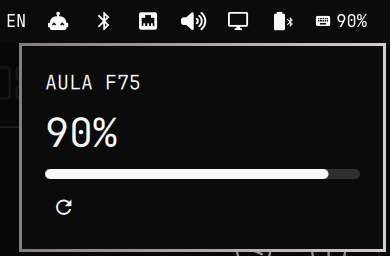

# AULA F75 Battery

Keyboard battery for the [Omarchy](https://omarchy.org) bar, read straight off
the AULA F75's Compx 2.4G receiver over raw HID.

The keyboard is invisible to UPower — its receiver declares no HID Battery
System usage page, so no `power_supply` node exists — and the vendor software
is Windows only. This asks the receiver directly.

The runtime is a single ~15 KB C helper, compiled from the source in this
repository on first run and cached. Nothing is downloaded and no binary is
shipped.

Works in **2.4G mode only**. A USB-C cable charges without disturbing the
radio, so the level and a charging state keep working while plugged in. With
the switch on wired the keyboard enumerates as a different device
(`258a:010c`) and is not supported.

## Requirements

- **A C compiler** (`cc`), to build the helper on first run. Omarchy already
  has one — `gcc`, by way of `base-devel`. The build is cached under
  `~/.cache/omarchy-aula-f75-battery` and repeats only when the source
  changes.
- **`libnotify`** (`notify-send`), for the low-battery notification only, and
  also standard on Omarchy. Without it the widget still reads and displays the
  battery; only the notification is skipped.
- **Root once**, for the udev rule below. Nothing else here runs privileged,
  and the plugin makes no network connections at all.

## Install

    omarchy plugin add https://github.com/azapc/omarchy-aula-f75-battery.git --enable
    cd ~/.config/omarchy/plugins/io.github.azapc.aula-f75-battery \
        && sudo ./install.sh

The second step is a one-time udev rule. It cannot be avoided: the kernel
creates `/dev/hidraw*` root-only, so nothing unprivileged can read the
receiver without an ACL, and Omarchy's plugin installer deliberately never
runs sudo or install hooks. The widget appears within a few seconds of the
rule landing — nothing to restart. If you skip the step it stays hidden, and
the shell log says the receiver is present but unreadable.

Two details in that rule are load-bearing. The `60-` prefix must sort before
systemd's `70-uaccess.rules`, which is what turns the tag into an ACL — a
higher number fails silently. And it uses `TAG+="uaccess"` rather than the
`MODE="0666"` older guides suggest, because these nodes carry the keyboard's
raw input stream, keystrokes included.

## Settings

Percentage next to the icon, low-battery threshold, low-battery notification,
and poll interval in seconds (default 30).

Polling wakes the radio to answer, so a shorter interval costs a little battery
to report battery. 30 s catches a cable being plugged in without being greedy.

## Behaviour

An idle keyboard ignores the first requests — the write wakes the radio and a
later one is answered — so each read retries six times across ~2.4 s. A read
still fails occasionally, so the widget holds its last reading for three polls
before blanking. An unplugged receiver clears it immediately instead.

## Removal

    omarchy plugin remove io.github.azapc.aula-f75-battery

The udev rule is installed outside the plugin directory, so removing the
plugin leaves it in place. To drop that too:

    sudo rm /etc/udev/rules.d/60-aula-f75.rules
    sudo udevadm control --reload-rules

And the cached helper binary, if you want the disk back:

    rm -rf ~/.cache/omarchy-aula-f75-battery

## Credit

Architecture and the probe's device scan follow
[hl.peripheral_battery](https://github.com/hlasensky/omarchy-peripheral-battery)
by hlasensky, which solves the same problem for the Steam Controller. Its
probe derives from [scbat](https://github.com/gregdel/scbat) by Grégoire
Delattre.

## License

MIT
